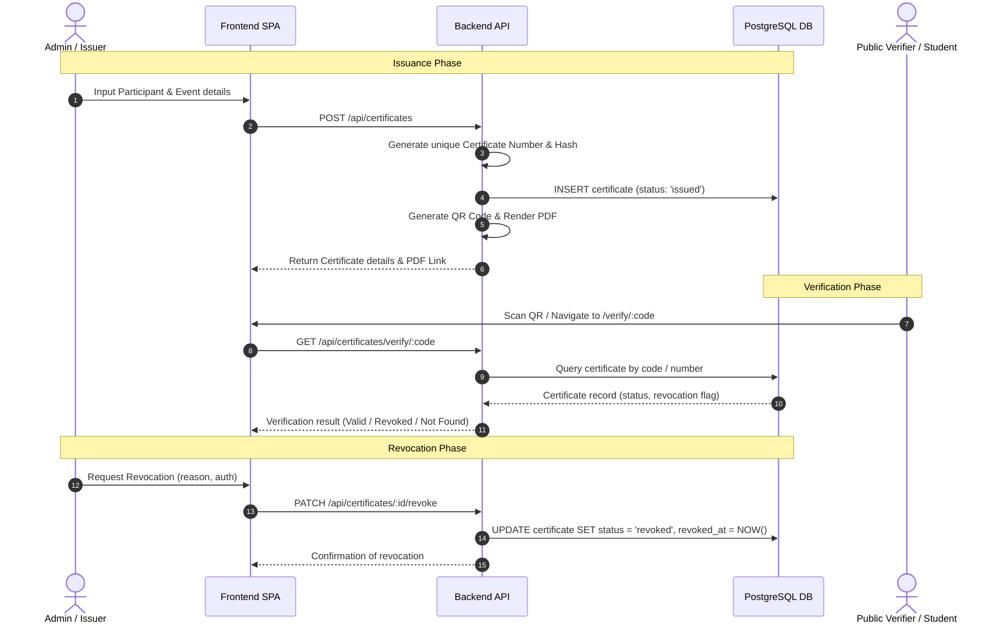

# Certificate Workflow & Lifecycle: HMI Certificate System

## 1. Implementation Status Summary

> [!IMPORTANT]
> **No certificate lifecycle features are currently implemented in the codebase.**
> There is currently no code for certificate generation, numbering, PDF rendering, QR generation, public verification, or revocation. The descriptions below define the planned lifecycle and requirements for future implementation.

---

## 2. Certificate Lifecycle: Planned Workflow

---

## 3. Lifecycle Stage Breakdown

### 1. Creation & Issuance
- **Current State**: `Not Implemented`.
- **Planned Flow**: Issuer provides recipient details and event selection via frontend admin form. Backend validates data using Zod, creates a database record, and assigns an issued timestamp.

### 2. Certificate Number Generation
- **Current State**: `Not Implemented`.
- **Planned Flow**: A cryptographically random or sequential prefixed unique identifier (e.g., `HMI-YYYY-XXXXXX` or UUID-based verification token) must be generated on the backend. This number must be enforced by a `UNIQUE` database constraint.

### 3. Participant & Event Associations
- **Current State**: `Not Implemented`.
- **Planned Flow**: A certificate must reference both a `participant_id` (foreign key) and an `event_id` (foreign key) to maintain strict data integrity.

### 4. PDF Generation & Downloads
- **Current State**: `Not Implemented`.
- **Dependencies**: No PDF generation library (such as PDFKit, Puppeteer, or `@react-pdf/renderer`) is currently installed in `apps/api` or `apps/web`. A library must be added when this feature is built.

### 5. QR Code Generation
- **Current State**: `Not Implemented`.
- **Dependencies**: No QR code library (such as `qrcode`) is currently installed.
- **Planned Flow**: The generated QR code should encode a direct public verification URL (e.g., `https://<domain>/verify/<verification_code>`).

### 6. Public Verification
- **Current State**: `Not Implemented`.
- **Authoritative Source of Validity**: The **backend database** is the sole authority for certificate validity. Client-side certificates (such as printed PDFs or QR strings) are unverified claims until checked against the database.
- **Security Guardrail**: The public verification endpoint must return only non-sensitive verification details (recipient name, event title, issue date, status) without exposing internal administrative metadata.

### 7. Revocation & Validity Checks
- **Current State**: `Not Implemented`.
- **Planned Flow**: Administrators may revoke a certificate by updating its status to `revoked` and recording the revocation reason and timestamp. The public verification endpoint must report the revoked status immediately.

---

## 4. Planned File Responsibilities

| Responsibility | Target File (When Implemented) | Layer |
| :--- | :--- | :--- |
| Certificate Routes | `apps/api/src/routes/certificates.ts` | Backend Router |
| Issuance & Numbering Service | `apps/api/src/services/certificate.ts` | Backend Service |
| PDF Renderer | `apps/api/src/services/pdf.ts` | Backend Service |
| QR Code Generator | `apps/api/src/services/qr.ts` | Backend Service |
| Certificate DB Schema | `apps/api/src/db/schema.ts` | Database Layer |
| Public Verification Page | `apps/web/src/routes/verify.tsx` | Frontend Page |
| Certificate Admin Dashboard | `apps/web/src/features/certificates/` | Frontend Feature Module |
