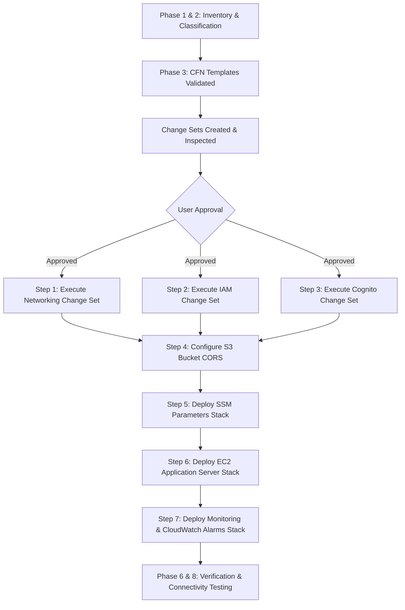

# Cloud Architecture & Verification Plan: HMI Certificate System

## 1. System Architecture Overview

The target cloud architecture deploys the HMI Certificate System onto AWS adhering strictly to faculty engineering rules, least-privilege security, cost optimization, and provider independence.

### Target Architecture Diagram

```mermaid
flowchart TB
    subgraph Internet ["Public Internet"]
        UserBrowser["User Web Browser (React SPA)"]
        PublicVerifier["Public Verifier (QR Scan / URL)"]
    end

    subgraph AWS ["AWS Account: 212641463846 (Region: ap-south-1 Mumbai)"]
        CognitoPool["Amazon Cognito User Pool\n(hmi-cert-user-pool)"]
        CognitoClient["Public App Client\n(SRP Auth - No Secret)"]
        CognitoPool --- CognitoClient

        subgraph VPC ["VPC: hmi-cert-vpc (10.20.0.0/16)"]
            IGW["Internet Gateway\n(hmi-cert-igw)"]

            subgraph PublicSubnets ["Public Subnets (Dual AZ)"]
                PubSub1["Public Subnet 1\n(10.20.0.0/20, ap-south-1a)"]
                EC2["EC2 API Server (t4g.micro AL2023)\nHono REST Backend (:3000)\nSG: hmi-cert-api-sg"]
                PubSub1 --- EC2
            end

            subgraph PrivateSubnets ["Private Subnets (Dual AZ - Isolated)"]
                PrivSub1["Private Subnet 1 (10.20.128.0/20)"]
                PrivSub2["Private Subnet 2 (10.20.144.0/20)"]
                RDS["Amazon RDS PostgreSQL 18.3\n(hmi-cert-postgres, db.t4g.micro)\nSG: hmi-cert-rds-sg (Port 5432)"]
                PrivSub1 --- RDS
                PrivSub2 --- RDS
            end

            S3Endpoint["VPC Gateway Endpoint\n(com.amazonaws.ap-south-1.s3)\n[Zero Cost Routing]"]
            EC2 -.->|Fast Direct Route| S3Endpoint
        end

        subgraph StorageMonitoring ["Storage, Secrets & Observability"]
            S3["Amazon S3 Bucket\n(hmi-cert-pdfs-212641463846-ap-south-1)\n- certificate-pdfs/\n- participant-imports/"]
            S3Endpoint --> S3

            SSM["SSM Parameter Store\n(/hmi-cert/api/*)"]
            CWLogs["CloudWatch Logs\n(/aws/hmi-cert/api)"]
            Alarms["CloudWatch Alarms\n- EC2 StatusCheckFailed\n- RDS CPU >80%\n- RDS FreeStorage <2GB"]
            SNS["Amazon SNS Alert Topic\n(hmi-cert-operational-alerts)"]
            Alarms --> SNS
        end
    end

    %% Interactions
    UserBrowser -->|1. Authenticate (SRP)| CognitoClient
    UserBrowser -->|2. JWT Bearer HTTP Requests| EC2
    PublicVerifier -->|Public Verify GET /api/certificates/verify/:id| EC2
    UserBrowser -.->|Direct Presigned PUT CSV| S3

    EC2 -->|3. TCP 5432 (SSL Required)| RDS
    EC2 -->|4. Private PDF Read/Write| S3
    EC2 -->|5. Fetch Config| SSM
    EC2 -->|6. Stream Logs| CWLogs
```

---

## 2. Comprehensive Resource Inventory

| Resource Type | Resource Identifier | Region | Existing / Planned | Role & Status |
| :--- | :--- | :--- | :--- | :--- |
| **AWS Account** | `212641463846` | Global | Active | Authenticated profile: `antigravity` (`Cert_Admin`) |
| **VPC** | `vpc-04aab780a5aa62ac1` | `ap-south-1` | Existing | `hmi-cert-vpc` (`10.20.0.0/16`) |
| **Internet Gateway**| `igw-0525858da52786dff` | `ap-south-1` | Existing | `hmi-cert-igw` attached to VPC |
| **Public Subnet 1** | `subnet-02bd64999afe6e6b2` | `ap-south-1` | Existing | `hmi-cert-subnet-public1-ap-south-1a` (`10.20.0.0/20`) |
| **Public Subnet 2** | `subnet-0f0078eb008458a23` | `ap-south-1` | Existing | `hmi-cert-subnet-public2-ap-south-1b` (`10.20.16.0/20`) |
| **Private Subnet 1**| `subnet-0e98e1ebe943e8044` | `ap-south-1` | Existing | `hmi-cert-subnet-private1-ap-south-1a` (`10.20.128.0/20`) |
| **Private Subnet 2**| `subnet-02213cb57c647d762` | `ap-south-1` | Existing | `hmi-cert-subnet-private2-ap-south-1b` (`10.20.144.0/20`) |
| **VPC S3 Endpoint** | `vpce-0eb37fc8ea8a2946e` | `ap-south-1` | Existing | Gateway endpoint to S3; routes in private route tables |
| **RDS PostgreSQL**  | `hmi-cert-postgres` | `ap-south-1` | Existing | PostgreSQL 18.3, `db.t4g.micro`, 20GB gp2, encrypted, private |
| **RDS Subnet Group**| `hmi-cert-db-subnet-group` | `ap-south-1` | Existing | Covers Private Subnets 1 & 2 |
| **API Security Group**| `sg-020819c796ff23596` | `ap-south-1` | Existing (Modifying) | `hmi-cert-api-sg`: Ingress 3000, 80, 443 added via CloudFormation |
| **RDS Security Group**| `sg-0eceb8b60da05d7ec` | `ap-south-1` | Existing | `hmi-cert-rds-sg`: Restricts 5432 to `hmi-cert-api-sg` |
| **S3 Bucket**       | `hmi-cert-pdfs-212641463846-ap-south-1` | `ap-south-1` | Existing | Private, AES-256 encrypted; CORS added for browser uploads |
| **IAM Instance Role**| `hmi-cert-api-instance-role-prod` | Global | Planned (Change Set ready) | SSM Managed Instance Core, S3 least privilege, CloudWatch agent |
| **Cognito User Pool**| `hmi-cert-user-pool-prod` | `ap-south-1` | Planned (Change Set ready) | Self-service registration, email verification, password policy |
| **Cognito App Client**| `hmi-cert-web-client-prod` | `ap-south-1` | Planned (Change Set ready) | Public client, SRP auth, no client secret |
| **EC2 Instance**    | `hmi-cert-api-server-prod` | `ap-south-1` | Planned | `t4g.micro` AL2023, Node.js 22, pnpm, PM2, CloudWatch agent |
| **SSM Parameters**  | `/hmi-cert/api/*` | `ap-south-1` | Planned | Secure runtime configuration store |
| **CloudWatch Log**  | `/aws/hmi-cert/api` | `ap-south-1` | Planned | Centralized log group with 14-day retention |
| **CloudWatch Alarms**| `hmi-cert-*-alarm` | `ap-south-1` | Planned | EC2 status check and RDS CPU/Storage alerts |
| **SNS Topic**       | `hmi-cert-operational-alerts-prod` | `ap-south-1` | Planned | Email alert delivery endpoint |

---

## 3. Dependency-Aware Deployment Execution Order



---

## 4. Connectivity & Verification Protocol

### Test 1: EC2 Keyless Administration via AWS Systems Manager
- **Objective**: Verify that EC2 can be managed securely without SSH keys or opening port 22.
- **Command**:
  ```bash
  aws ssm describe-instance-information --filters "Key=InstanceIds,Values=<INSTANCE_ID>" --profile antigravity --region ap-south-1
  ```
- **Success Criteria**: Status = `Online`, PingStatus = `Online`.

### Test 2: EC2 to Amazon RDS PostgreSQL Connectivity
- **Objective**: Verify that the EC2 instance can reach PostgreSQL port 5432 on `hmi-cert-postgres.cdmi866iew37.ap-south-1.rds.amazonaws.com` through the private subnet routing and security group rules.
- **Command**:
  ```bash
  aws ssm send-command \
    --instance-ids "<INSTANCE_ID>" \
    --document-name "AWS-RunShellScript" \
    --parameters 'commands=["nc -zv hmi-cert-postgres.cdmi866iew37.ap-south-1.rds.amazonaws.com 5432"]' \
    --profile antigravity --region ap-south-1
  ```
- **Success Criteria**: `Connection to ... 5432 port [tcp/postgresql] succeeded!`

### Test 3: EC2 to Amazon S3 Least-Privilege Permissions
- **Objective**: Verify that the attached instance profile can write and read from `s3://hmi-cert-pdfs-212641463846-ap-south-1/` via the VPC Gateway Endpoint without static AWS access keys.
- **Command**:
  ```bash
  aws ssm send-command \
    --instance-ids "<INSTANCE_ID>" \
    --document-name "AWS-RunShellScript" \
    --parameters 'commands=["echo smoke-test > /tmp/test.txt && aws s3 cp /tmp/test.txt s3://hmi-cert-pdfs-212641463846-ap-south-1/certificate-pdfs/smoke-test.txt && aws s3 rm s3://hmi-cert-pdfs-212641463846-ap-south-1/certificate-pdfs/smoke-test.txt"]' \
    --profile antigravity --region ap-south-1
  ```
- **Success Criteria**: Upload and delete operations return code 0.

### Test 4: Cognito Public Authentication & Token Verification
- **Objective**: Verify that the Cognito User Pool and App Client allow user signup/login and that backend middleware can decode and verify Cognito JWTs.
- **Verification**: `aws cognito-idp describe-user-pool-client --user-pool-id <ID> --client-id <ID>`.

---

## 5. Monthly Cost Breakdown & Budget Analysis

| Service & Specification | Monthly Cost Estimate (ap-south-1) | Cost Control Mechanism |
| :--- | :--- | :--- |
| **Amazon RDS PostgreSQL** (`db.t4g.micro`, 20GB gp2) | ~$13.50 / month | Single-AZ deployment; eligible for 12 months Free Tier |
| **Amazon EC2** (`t4g.micro` AL2023, 10GB gp3) | ~$6.20 / month | ARM Graviton2 cost efficiency; eligible for Free Tier |
| **Amazon S3** (Storage & API requests) | ~$0.20 / month | Auto-deletion of abandoned CSVs after 7 days |
| **VPC Gateway Endpoint (S3)** | **$0.00** | Free; avoids expensive NAT Gateway ($32+/mo) |
| **Amazon Cognito User Pools** | **$0.00** | Free tier includes up to 50,000 MAUs |
| **SSM Parameter Store (Standard)** | **$0.00** | Standard parameters are free |
| **CloudWatch Logs & Metrics** | ~$0.50 / month | 14-day retention limit; 5GB free ingestion |
| **Amazon SNS (Email Alerts)** | **$0.00** | First 1,000 notifications/month free |
| **Total Estimated Run Rate** | **~$20.40 / month** | **$0 - $5 / month with active AWS Free Tier** |

> [!NOTE]
> An existing AWS Budget (`AWS Budget`) is configured on Account `212641463846` with a $1.00 USD monthly threshold. Note that budget notifications notify administrators of spend thresholds, but do not automatically terminate running instances.

---

## 6. Safe Teardown & Cleanup Guide

Distinguishing safe resource cleanup from destructive operations on retain/data-bearing resources:

### Safe to Delete (Stateless / Compute Stacks)
These stacks can be deleted without data loss:
- `hmi-cert-monitoring-alerts` (CloudWatch Alarms & SNS topic)
- `hmi-cert-ec2-backend` (EC2 instance; code is in git repository)
- `hmi-cert-parameters` (SSM parameters)
- `hmi-cert-networking-security` (Security group ingress rules)
- `hmi-cert-iam-roles` (IAM instance role & profile)

### Requires Explicit Protection (Data-Bearing Resources)
**NEVER delete or recreate without explicit verification and backup:**
1. **RDS Instance `hmi-cert-postgres`**: Contains all users, events, participant registrations, certificates, and audit logs. Has `DeletionPolicy: Retain` and automated backups.
2. **S3 Bucket `hmi-cert-pdfs-212641463846-ap-south-1`**: Contains generated certificate PDFs and verification records. Has `DeletionPolicy: Retain`.
3. **Cognito User Pool `hmi-cert-user-pool-prod`**: Deleting the user pool destroys user authentication records.
